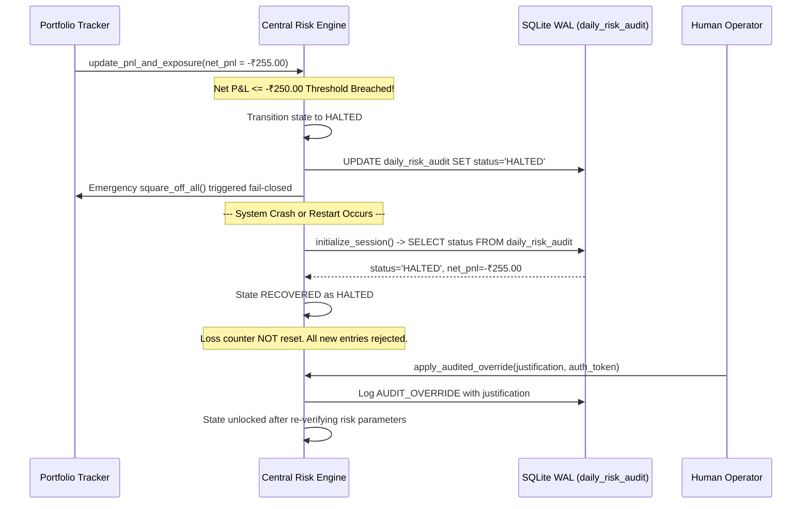

# Central Risk Management & Circuit Breaker Engine

## 1. Risk Sovereignty Principles
The Central Risk Engine (`risk/engine.py`) is the ultimate, fail-closed authority governing order acceptance, position exposure, and capital protection:
- **No Agent Override:** An AI agent, strategy, or external caller has zero routes or tools to override the Risk Engine.
- **Fail-Closed Stance:** If any market data tick is stale (>5s), contract data is ambiguous, capital headroom is insufficient, or connection drops, the proposal is rejected immediately.
- **Strict Capital & Loss Ceiling:**
  - Starting Capital: Under ₹25,000.
  - Maximum Daily Loss Limit: **₹250.00** across Realized P&L, Unrealized mark-to-market P&L, and full statutory transaction costs.
  - When the ₹250 threshold is breached, the engine transitions immediately to `HALTED`. System restarts or crashes recover the halt state from SQLite and **cannot reset the loss counter**.

---

## 2. The 12 Pre-Trade Deterministic Gates

Every proposal passed to `CentralRiskEngine.evaluate_proposal()` must pass all 12 gates sequentially:

| Gate # | Name | Condition / Logic | Rejection Reason |
|---|---|---|---|
| **1** | System State | Must be in `ACTIVE` state. Blocks if `HALTED` or `KILL_SWITCH_ACTIVE`. | "System is in HALTED state. Limit reached." |
| **2** | Market Window | Time must be within 09:15:00 and 15:00:00 IST on a valid trading day. | "Outside permitted intraday entry window." |
| **3** | Instrument Whitelist | Instrument must be tradable, active, and present in Instrument Master. | "Instrument not authorized or tradable." |
| **4** | Quote Freshness | Age of latest market tick quote must be $\le 5.0$ seconds. | "Stale market data (>5.0s age)." |
| **5** | Capital Ceiling | Required margin must be $\le \text{Available Capital}$ ($\le ₹25,000$). | "Insufficient capital / exceeds ₹25,000 ceiling." |
| **6** | Per-Trade Risk Cap | $|\text{Entry} - \text{Stop}| \times \text{Qty} + \text{Costs} \le ₹250.00$. | "Per-trade risk exceeds ₹250.00 cap." |
| **7** | Cumulative Drawdown | $\text{Current Net PnL} - \text{Proposed Risk} > -₹250.00$. | "Potential drawdown breaches ₹250 daily loss limit." |
| **8** | Max Open Positions | Active open positions count must be $< 2$. | "Maximum simultaneous positions (2) reached." |
| **9** | Max Daily Trades | Total executed trades today must be $< 6$. | "Maximum daily trades limit (6) reached." |
| **10** | Deduplication | Rejects identical symbol + direction within 10-second window. | "Duplicate order proposal detected." |
| **11** | Geometry Sanity | Long: $\text{Stop} < \text{Price} < \text{Target}$. Short: $\text{Target} < \text{Price} < \text{Stop}$. | "Invalid stop loss or target geometry." |
| **12** | Cooldown Throttle | Elapsed time since last trade execution must be $\ge 30.0$ seconds. | "Rapid-fire cooldown active." |

---

## 3. Indian Market Statutory Cost Model

All P&L calculations (realized, unrealized, and net headroom) model exact round-trip statutory charges:

1. **Brokerage:**
   - Cash Equity (EQ): $\min(₹20.00, \text{Turnover} \times 0.0005)$ per executed leg.
   - Derivatives (F&O): Flat ₹20.00 per executed order leg (₹40.00 round trip).
2. **Securities Transaction Tax (STT):**
   - Equity Intraday: $0.025\%$ charged on the SELL side.
   - Futures: $0.0125\%$ on SELL side.
   - Options: $0.1\%$ on SELL side premium turnover.
3. **Exchange Turnover Charges:**
   - NSE Cash: $0.00297\%$ of total turnover.
   - NSE F&O: $0.0019\%$ on Futures; $0.03503\%$ on Options premium turnover.
4. **SEBI Turnover Fee:**
   - ₹10 per Crore ($0.0001\%$) of total turnover.
5. **GST:**
   - $18\%$ applied to $(\text{Brokerage} + \text{Exchange Turnover} + \text{SEBI Fee})$.
6. **Stamp Duty:**
   - $0.003\%$ charged on the BUY side turnover.

---

## 4. Halt Persistence & Tamper-Resistant Recovery

---

## 5. Emergency Kill Switch Protocols

1. **Triggering:**
   - Can be triggered via Dashboard UI button, REST API (`POST /api/v1/risk/kill-switch`), or Telegram bot (`/kill <reason>`).
2. **Actions:**
   - System state moves instantly to `KILL_SWITCH_ACTIVE`.
   - All pending orders in `PaperBroker` are immediately cancelled (`CANCELLED`).
   - All active positions in `PortfolioTracker` are closed via immediate market square-off (`KILL_SWITCH_SQUARE_OFF`).
   - Critical audit entry logged to `system_audit_logs`.
3. **Resetting:**
   - Requires explicit justification reason. Logged to SQLite audit trail before resetting.
