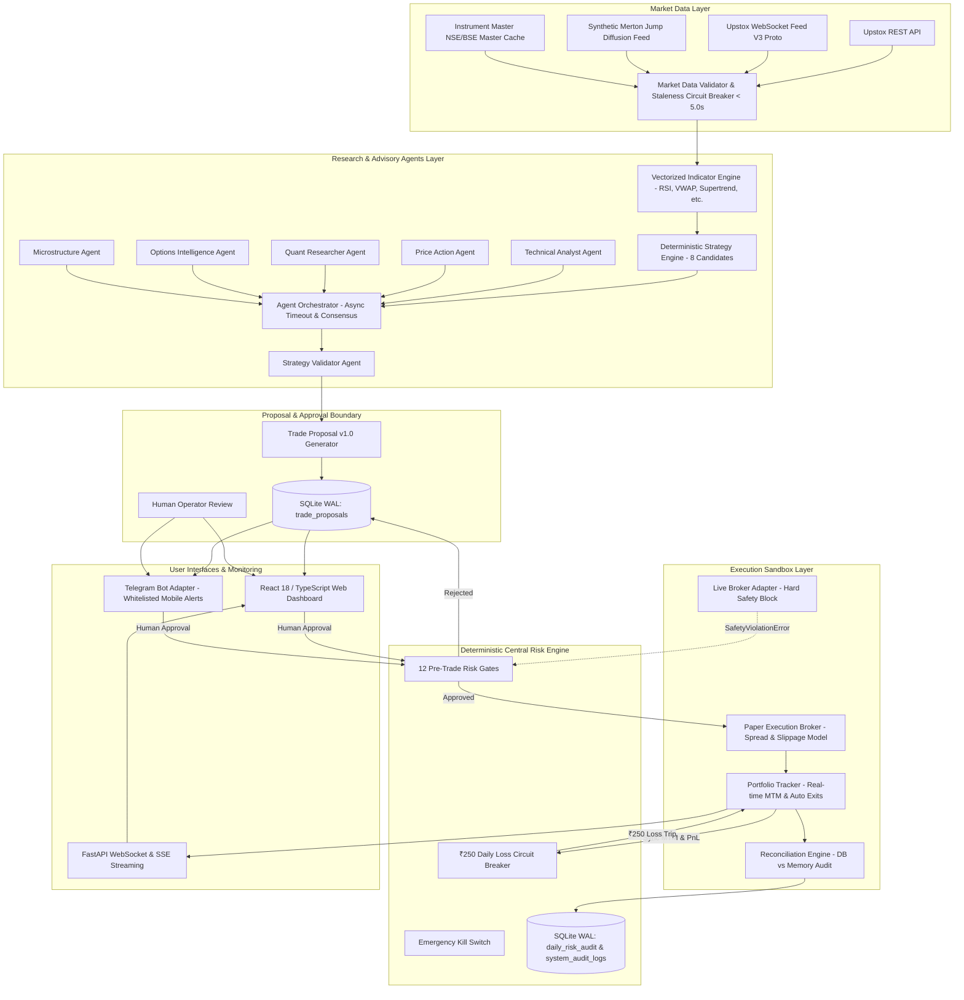

# System Architecture Specification

## 1. Executive Overview
The **Indian Multi-Agent Trading System** is a modular, locally hosted platform engineered for quantitative research, deterministic strategy validation, event-driven backtesting, simulated paper trading, and human-in-the-loop proposal approvals for Indian financial markets (NSE and BSE cash equities and derivatives).

The system enforces a **Fail-Closed Stance**, **Deterministic Risk Sovereignty**, strict capital caps (under ₹25,000 starting capital), and a **hard daily loss limit of ₹250.00 maximum** across realized P&L, unrealized mark-to-market P&L, and all Indian statutory transaction costs.

---

## 2. High-Level Architecture Diagram

---

## 3. Subsystem Boundaries and Responsibilities

### 3.1 Market Data & Validation
- **Authentic Provenance:** All quotes originate from authenticated broker adapters (`UPSTOX_REST`, `UPSTOX_WS_FEED_V3`) or an explicitly labeled fixture (`SYNTHETIC_FIXTURE`).
- **Protobuf Feed V3:** Decodes binary frames streamed over Upstox WebSocket Feed V3 using compiled Google Protocol Buffers schemas.
- **5-Second Staleness Circuit Breaker:** Quotes with latency $> 5.0$ seconds are flagged stale fail-closed.
- **Instrument Master:** Maintains indexed cache of tradable equity and derivatives symbols, lot sizes, tick sizes, and strike intervals.

### 3.2 Deterministic Strategy Engine & Agent Advisory
- **Indicator Suite:** Vectorized, high-performance calculations for SMA, EMA, RSI, VWAP, Supertrend, Bollinger Bands, ATR, and ADX.
- **8 Candidate Strategies:**
  1. `VWAP_Continuation`: Mean-reverting momentum relative to intraday VWAP.
  2. `EMA_Crossover`: 9/21 exponential moving average trend filter.
  3. `RSI_Momentum`: Overbought/oversold pullback entries.
  4. `Opening_Range_Breakout`: 15-minute opening range expansion.
  5. `Supertrend_Trend`: ATR-based trailing trend following.
  6. `Support_Resistance_Breakout`: Horizontal pivot level expansion.
  7. `Volume_Breakout`: High-volume price expansion.
  8. `Mean_Reversion`: Bollinger Band 2-sigma reversion.
- **Multi-Agent Advisory Framework:**
  - Independent specialist agents evaluate market conditions with strict 2.0-second timeout isolation.
  - Advisory output is non-binding: agents cannot place orders or alter risk parameters.
  - Contradiction detector flags conflicting signals between specialists.

### 3.3 Human Approval & Proposal Service
- **Trade Proposal Schema v1.0:** Strictly typed Pydantic proposal contracts detailing symbol, direction, entry, stop loss, target, quantity, risk INR, reward INR, statutory charges, supporting evidence, and contradictions.
- **Human Sovereign Gate:** Proposals are saved to SQLite with `human_decision="PENDING"`. An operator must explicitly approve via the Web Dashboard or whitelisted Telegram command before submission to the Risk Engine.

### 3.4 Central Risk Engine (Fail-Closed Deterministic Authority)
- **12 Pre-Trade Gates:**
  1. System State (Blocks if `HALTED` or `KILL_SWITCH_ACTIVE`)
  2. Session Window (09:15 to 15:15 IST only)
  3. Instrument Whitelist & Tradability
  4. Stale Quote Check ($< 5.0$s)
  5. Starting Capital Constraint ($\le ₹25,000$)
  6. Per-Trade Risk Ceiling ($\le ₹250.00$)
  7. Portfolio Drawdown Sim ($\text{Current Loss} + \text{Trade Risk} \le ₹250.00$)
  8. Max Open Positions ($\le 2$)
  9. Rate Limiter (Sliding window order throttle)
  10. Duplicate Proposal Deduplication (10-second window)
  11. Stop Loss & Target Geometry
  12. Rapid-Fire Cooldown Protection (30-second interval between trades)
- **₹250 Daily Loss Circuit Breaker:** When cumulative net loss reaches ₹250.00, engine immediately transitions to `HALTED` and auto-squares off all positions.
- **Tamper-Resistant Restart Recovery:** Persisted in SQLite `daily_risk_audit`. On crash or restart, the engine recovers `HALTED` state directly, preventing loss resets.
- **Emergency Kill Switch:** Instant operator cutoff with square-off cascade.

### 3.5 Execution & Portfolio Layer
- **Paper Broker:** Realistic microstructure simulation including bid-ask spread crossing, slippage modeling (0.01% - 0.02%), and Indian statutory charges.
- **Portfolio Tracker:** Continuous mark-to-market valuation, automated intrabar Stop Loss and Target exit execution, and mandatory 15:15 IST intraday square-off.
- **Reconciliation Engine:** Regular audits comparing in-memory portfolio objects against SQLite database rows and Risk Engine P&L.
- **Live Safety Barrier:** `LiveBrokerAdapter` permanently raises `SafetyViolationError`.

### 3.6 User Interfaces
- **Local Dashboard:** React 18 + TypeScript + Tailwind CSS application compiled to production assets and served directly by FastAPI.
- **Real-Time Streaming:** WebSockets and Server-Sent Events (SSE) broadcasting live ticks, P&L, ₹250 progress bar, and proposals.
- **Telegram Bot:** Whitelisted mobile alerts and one-click `/approve`, `/reject`, `/status`, and `/kill` commands.

---

## 4. Process Model & Concurrency

The backend operates as an asynchronous, single-process ASGI service powered by `uvicorn` and `asyncio`:
- **SQLite WAL Mode:** Write-Ahead Logging allows concurrent reads alongside writes without database locking.
- **Non-blocking Event Loops:** Agent evaluations run concurrently using `asyncio.gather` bounded by individual 2.0s timeouts.
- **Event-Driven Broker & Risk Callbacks:** In-memory events broadcast synchronously to WebSocket clients with dead connection cleanup.
